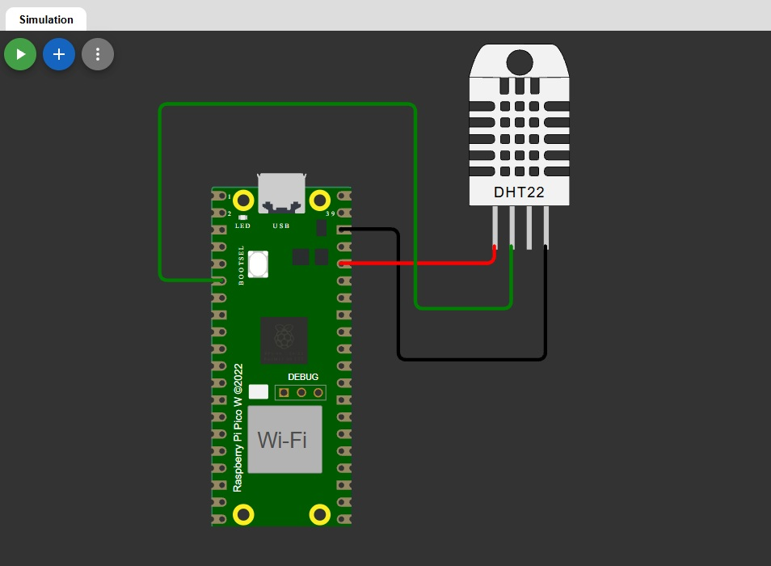
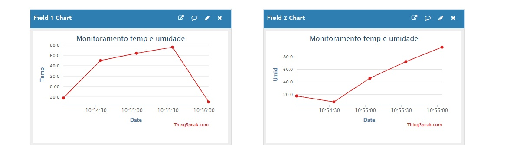

# IoT Temperature and Humidity Monitoring 🌡️

## Overview

This project consists of an IoT-based temperature and humidity monitoring system developed using MicroPython and a Raspberry Pi Pico W.

The system uses a DHT22 sensor to collect environmental data and sends the measurements over Wi-Fi to the ThingSpeak cloud platform, where they can be stored and visualized.

The project was developed as part of an academic activity and simulated using Wokwi.

## Technologies

- **Programming Language:** MicroPython
- **Hardware:** Raspberry Pi Pico W
- **Sensor:** DHT22
- **Cloud Platform:** ThingSpeak
- **Communication:** Wi-Fi and HTTP
- **Simulation:** Wokwi

## Hardware Components

- Raspberry Pi Pico W
- DHT22 Temperature and Humidity Sensor

## How It Works

1. The Raspberry Pi Pico W initializes its Wi-Fi connection.
2. The DHT22 sensor measures the room temperature and humidity.
3. The collected measurements are sent to ThingSpeak through an HTTP POST request.
4. ThingSpeak stores the information in two separate fields:
   - **Field 1:** Temperature (°C)
   - **Field 2:** Humidity (%)
5. The process repeats every 20 seconds.

## Project Structure

```text
monitoramento-temperatura-umidade-iot/
│
├── main.py
├── diagram.json
├── README.md
├── .gitignore
│
└── images/
    ├── micropythonpicow.jpg
    └── thingspeakexample.jpg
```

- `main.py`: Main MicroPython application.
- `diagram.json`: Wokwi circuit configuration, including components and connections.
- `README.md`: Project documentation.
- `.gitignore`: Specifies files that should not be tracked by Git.
- `images/`: Contains screenshots of the simulation and ThingSpeak dashboard.

## Simulation

The project was developed and tested using the Wokwi online simulator.

### Wokwi Circuit Simulation



### ThingSpeak Data Visualization



## Configuration

Before running the project, replace the placeholder `YOUR_THINGSPEAK_API_KEY` in `main.py` with your own ThingSpeak Write API Key.

The default Wi-Fi configuration for the Wokwi simulation is:

```python
WIFI_SSID = "Wokwi-GUEST"
WIFI_PASSWORD = ""
```

**Important:** Never upload personal API Keys, passwords, or other private credentials to a public repository.

## Learning Objectives

This project provided practical experience with:

- MicroPython programming.
- Raspberry Pi Pico W development.
- Temperature and humidity data acquisition.
- Wi-Fi connectivity.
- HTTP requests and API integration.
- IoT concepts.
- Cloud-based data monitoring and visualization.